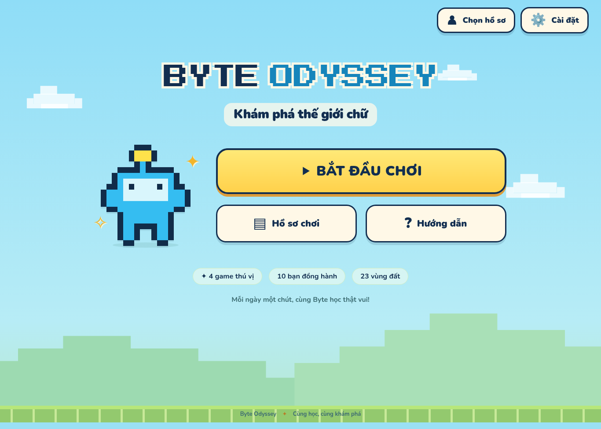
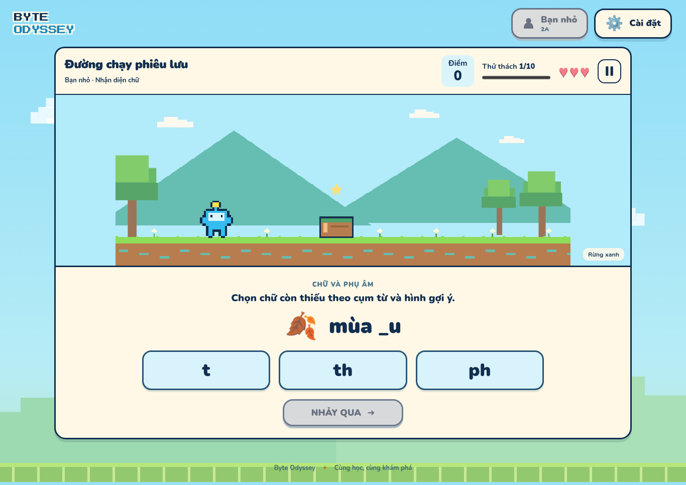

# Byte Odyssey

**Khám phá thế giới chữ** — game luyện nhận diện chữ tiếng Việt cho học sinh lớp 2.



## Chơi trên Windows

Vào [Releases](https://github.com/hpb282/byte-odyssey/releases) và chọn bản phát hành đã build thành công:

- `Byte-Odyssey-0.1.0-Setup-x64.exe`: bộ cài Windows, có icon Robot Byte và lối tắt trên Desktop/Start Menu.
- `Byte-Odyssey-0.1.0-Portable-x64.exe`: mở và chơi không cần cài đặt.
- `Byte-Odyssey-0.1.0-Web.zip`: bản web để đưa lên máy chủ tĩnh.

Bản desktop dành cho **Windows 10/11 64-bit** và chơi được khi không có Internet. Tệp **Source code (zip)** của GitHub là mã nguồn để phát triển, không phải bộ cài. Các bản hiện tại chưa ký số bằng chứng chỉ nhà phát hành; bản phát hành có file `SHA256SUMS.txt` để đối chiếu tệp tải về.

## Có gì trong game?

| Game | Hành động khi làm đúng | Map |
| --- | --- | ---: |
| Đường chạy phiêu lưu | Nhảy qua vật cản | 5 |
| Phi thuyền không gian | Bắn thiên thạch mở đường | 6 |
| Đường đua kỳ thú | Tăng tốc vượt trạm | 6 |
| Leo núi tìm sao | Leo thêm một bậc | 6 |

- **10 nhân vật**, được chọn tự do trong mọi game.
- **23 map** chỉ thay hình ảnh; luật, độ khó và bộ vật cản trong cùng game giữ nguyên.
- **120 bài tự biên soạn**, chia đều ba nhóm: nhận diện chữ; vần và dấu thanh; ghép từ và câu.
- Bài chọn đáp án, ghép từ, xếp mảnh câu và nối từ với tranh. Bấm chọn dùng được bằng chuột, cảm ứng và bàn phím.
- Không ghi âm hoặc đánh giá phát âm.

### Luật chơi

Chọn **hồ sơ → nội dung → game → nhân vật → map → bắt đầu**. Mỗi lượt có 10 thử thách và 3 tim (3 ô năng lượng trong game phi thuyền).

- Đúng lần đầu: **10 điểm**; đúng sau khi sửa: **5 điểm**.
- Chỉ chấm khi bài làm đủ và bấm nút hành động. Đổi lựa chọn hoặc ghép dở chưa mất tim.
- Xác nhận sai: mất một tim, có gợi ý và được làm lại cùng bài nếu còn tim.
- Hết tim thì kết thúc; làm đủ 10 bài thì hoàn thành. Điểm tối đa 100.
- Nhân vật và vật cản chờ khi học sinh làm bài; không tính điểm theo tốc độ đọc.
- Có tạm dừng, chơi lại, điều chỉnh âm thanh và giảm chuyển động.



## Hồ sơ và dữ liệu học sinh

Tên, lớp, điểm, lịch sử từng lần thử và bài cần luyện thêm được lưu **trên thiết bị/trình duyệt đang dùng**, không tự đồng bộ giữa các máy. Có thể tiếp tục lượt đang chơi sau khi đóng/mở ứng dụng.

Trong **Hồ sơ chơi**:

- **Sao lưu tất cả (JSON)** để giữ dữ liệu hoặc chuyển máy.
- **Nhập bản sao lưu** để hợp nhất hồ sơ và kết quả, không nhân đôi lượt cũ.
- **Xuất bảng điểm (CSV)** để xem trong ứng dụng bảng tính.
- Lọc theo học sinh, xem từng đáp án và các mục cần luyện thêm.

Xóa dữ liệu trình duyệt hoặc xóa thư mục dữ liệu ứng dụng sẽ làm mất hồ sơ chưa sao lưu. Tỉ lệ đúng được tính trên **tất cả lần xác nhận**, bao gồm cả lần trả lời sai trước khi sửa.

## Chạy mã nguồn

Cần **Node.js 24** và npm.

```sh
npm ci
npm run dev
```

Mở địa chỉ do Vite in ra. Để chạy bản build:

```sh
npm run build
npm run preview
```

Bản web hỗ trợ lưu ngoại tuyến sau lần tải đầy đủ đầu tiên trên HTTPS hoặc máy cục bộ. Cần phục vụ thư mục `dist` bằng máy chủ HTTP; không mở trực tiếp `dist/index.html` trong trình duyệt bằng cách nhấp đúp.

### Bản desktop và bộ cài Windows

```sh
npm run desktop
```

Trên máy Windows:

```sh
npm ci
npm run dist:win
```

Hai file `.exe` xuất hiện trong `release/`. Electron và công cụ đóng gói cần Internet ở lần chuẩn bị đầu tiên. Icon PNG/ICO nằm tại [assets/branding](assets/branding).

### Kiểm tra

```sh
npm test
npm run build
npx playwright install chromium
npm run test:e2e
```

Nếu đã có Chromium hệ thống, có thể đặt `PLAYWRIGHT_CHROMIUM_EXECUTABLE_PATH` trỏ đến tệp trình duyệt. Kiểm tra ứng dụng desktop:

```sh
npm run install:desktop
node scripts/smoke-desktop.mjs
```

## Tự động tạo bản phát hành

[GitHub Actions](https://github.com/hpb282/byte-odyssey/actions) kiểm tra luật chơi, học liệu, hồ sơ, build và chơi thật trên trình duyệt. Job Windows đóng gói bộ cài + portable, chạy thử ứng dụng đã đóng gói và tạo mã SHA-256.

Push tag trùng phiên bản trong `package.json`, ví dụ `v0.1.0`, để workflow tạo GitHub Release và đính kèm các tệp tải. Nếu job chưa hoàn thành, xem Artifacts/nhật ký trong Actions; chưa có tệp phát hành cho đến khi job Windows thành công.

## Học liệu và tài liệu

- [Nguyên tắc biên soạn học liệu](docs/hoc-lieu.md) · [120 bài dạng JSON](docs/hoc-lieu.json).
- Nguồn học liệu có cấu trúc tại [src/questions.ts](src/questions.ts), xem được ngay trong game ở **Hướng dẫn → Bộ học liệu**.
- [Luồng giao diện đã duyệt](docs/luong-chon-va-man-hinh.md) và [thiết kế dự án](docs/thiet-ke-game.md).
- [Kiến trúc và lưu dữ liệu](docs/kien-truc.md) · [Nguồn tài nguyên](docs/nguon-tai-nguyen.md).
- [Phạm vi và kết quả kiểm thử](docs/kiem-thu.md).

Đây là học liệu tự biên soạn, không phải trích nguyên bài đọc từ sách giáo khoa hay công cụ chứng nhận năng lực. Giáo viên có thể xem trước để chọn nội dung phù hợp với lớp.
