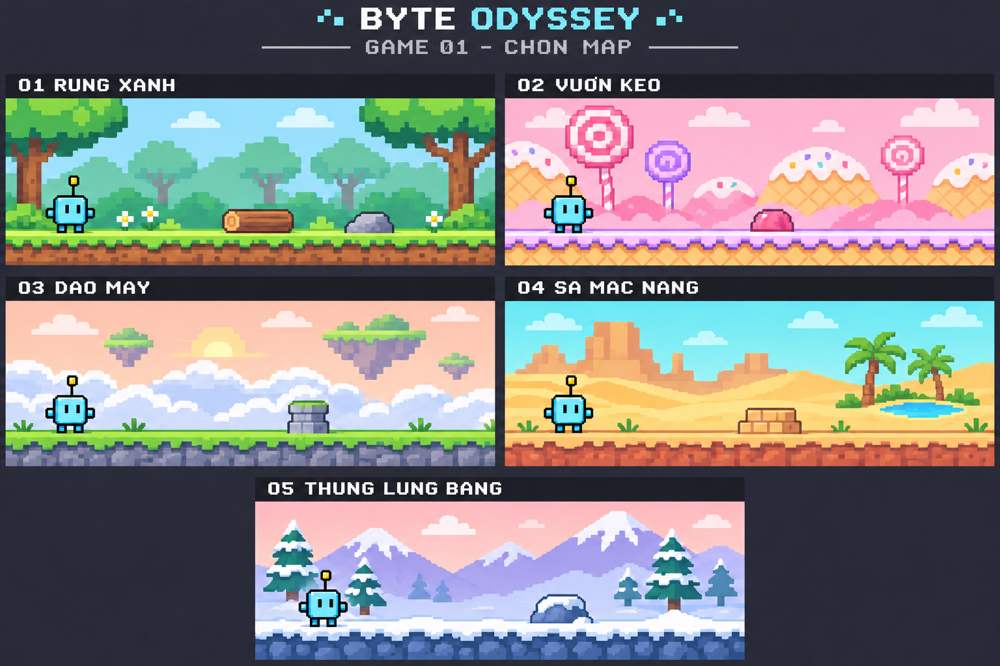

# Đường chạy phiêu lưu — Năm map đã chốt

Game 1 sử dụng 5 map dưới đây. Học sinh hoặc giáo viên tự chọn map trước khi
bắt đầu mỗi lượt chơi; cả 5 map đều được chọn ngay từ đầu.

Mục đích của map là tạo cảm giác mới mẻ và khuyến khích học sinh muốn chơi.
Map chỉ thay cảnh nền và ngoại hình chướng ngại vật; luật chơi và bộ chướng
ngại vật dùng chung cho cả 5 map.

| Mã | Tên map | Cảnh quan và màu sắc | Ví dụ ngoại hình của cùng một vật cản |
| --- | --- | --- | --- |
| 01 | Rừng xanh | Cây xanh, trời sáng, đường cỏ và hoa nhỏ | Khúc gỗ thấp |
| 02 | Vườn kẹo | Cây kẹo, đồi bánh, nền hồng và kem | Viên kẹo dẻo |
| 03 | Đảo mây | Đảo nổi, mây trắng, bầu trời bình minh | Trụ đá thấp |
| 04 | Sa mạc nắng | Cồn cát vàng, núi đá, ốc đảo và cây cọ | Khối sa thạch |
| 05 | Thung lũng băng | Núi tuyết, cây thông, màu trắng và tím nhạt | Đá phủ tuyết |

## Chọn map trước khi chơi

1. Vào Game 1: Đường chạy phiêu lưu.
2. Tại màn chuẩn bị, chọn nội dung luyện tập, một trong 10 nhân vật và một
   trong 5 map. Các lựa chọn này độc lập với nhau.
3. Bấm **Bắt đầu** để vào lượt chơi trên map đã chọn.
4. Khi kết thúc hoặc bắt đầu lượt chơi mới, có thể quay lại màn chuẩn bị để
   đổi map.

Mỗi lượt chơi dùng một map xuyên suốt 10 thử thách. Không cần hoàn thành map
trước để mở map sau, và không bắt buộc chơi các map theo thứ tự.

## Nguyên tắc dùng trong game

- Mỗi map là một cách thể hiện hình ảnh của cùng màn chơi chạy và vượt chướng
  ngại vật đã thống nhất.
- Với cùng cấu hình màn chơi, cả 5 map dùng cùng loại, số lượng, thứ tự, vị trí
  và khoảng cách giữa các chướng ngại vật.
- Các vật cản tương ứng có cùng kích thước va chạm và hành vi; chỉ thay hình
  vẽ, màu sắc và chi tiết trang trí cho phù hợp với map.
- Tốc độ chạy, cách nhảy và điểm chờ trước vật cản giống nhau giữa các map.
- Học sinh giải bài tập nhận diện chữ, ghép hoặc nối; làm đúng để nhân vật vượt qua.
- Nhân vật chờ an toàn khi học sinh làm bài; bối cảnh không tạo thêm giới hạn thời gian.
- Luật 10 thử thách, 3 trái tim, cách tính điểm, gợi ý và điều kiện kết thúc
  giống nhau giữa các map. Map không làm thay đổi độ khó.
- Bài tập phụ thuộc nhóm nội dung luyện tập đã chọn, không phụ thuộc map.
- Các chi tiết băng, mây và cát là hình ảnh trang trí, không thêm hiệu ứng
  làm thay đổi cách di chuyển hoặc cách vượt chướng ngại vật.
- Cả 10 nhân vật đều có thể dùng. Robot Byte trong ảnh chỉ là nhân vật minh họa.
- Chữ và bảng bài tập sẽ nằm trên khu vực riêng có nền rõ ràng khi thiết kế màn
  hình chơi, để các màu sắc của map không ảnh hưởng đến việc đọc.
- Kết quả lưu hồ sơ cần ghi nhận map đã chọn cùng thông tin lượt chơi.
- Ảnh là phác thảo cho 5 bối cảnh đã chốt, chưa phải bộ tài nguyên chạy trong game.
