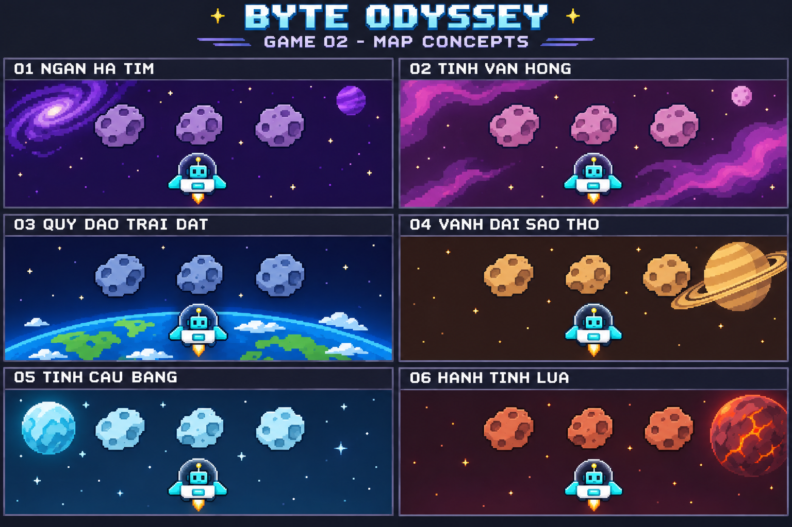

# Phi thuyền không gian — Sáu map đã duyệt

Người dùng đã duyệt bộ 6 map dưới đây cho Game 2.

| Mã | Tên map | Bối cảnh | Ngoại hình thiên thạch |
| --- | --- | --- | --- |
| 01 | Ngân hà tím | Không gian chàm, thiên hà và hành tinh tím phía xa | Đá tím xám |
| 02 | Tinh vân hồng | Những dải tinh vân hồng, tím và mặt trăng nhỏ | Đá hồng trầm |
| 03 | Quỹ đạo Trái Đất | Trái Đất xanh với đại dương, lục địa và mây ở hậu cảnh | Đá xanh xám |
| 04 | Vành đai Sao Thổ | Sao Thổ và các vành đai vàng trên nền không gian nâu sẫm | Đá vàng cát |
| 05 | Tinh cầu băng | Hành tinh xanh băng và những ngôi sao trắng trên nền xanh đậm | Đá xanh băng |
| 06 | Hành tinh lửa | Hành tinh đỏ cam với các vệt dung nham ở phía xa | Đá đỏ gạch |

## Nguyên tắc chung

- Mục đích của map là tạo cảm giác mới mẻ, khuyến khích học sinh muốn chơi.
- Các map chỉ đổi cảnh nền và ngoại hình thiên thạch; dùng cùng luật chơi
  và cùng bộ vật cản của Game 2.
- Với cùng cấu hình màn, số lượng, thứ tự, vị trí, khoảng cách, kích thước
  va chạm và hành vi của thiên thạch giống nhau giữa các map.
- Cách bay, cách bắn, thời gian chờ, độ khó, năng lượng và tính điểm không
  thay đổi theo map. Băng, vành đai và dung nham chỉ là trang trí hậu cảnh.
- Bài tập phụ thuộc nhóm nội dung luyện tập được chọn, không phụ thuộc map.
- Cả 10 nhân vật đã chốt đều có thể làm phi công trên mọi map. Robot Byte
  trong ảnh là nhân vật minh họa.
- Các bản phác thảo dùng cùng đội hình ba thiên thạch để so sánh hình ảnh,
  không xác định thêm số bài tập hoặc cách tính điểm cho mỗi đợt.
- Ảnh là tài liệu chọn phong cách, chưa phải bộ tài nguyên chạy trong game.

Học sinh hoặc giáo viên có thể chọn map khi chuẩn bị lượt chơi. Chọn map
không thay đổi nội dung luyện tập hoặc độ khó.
