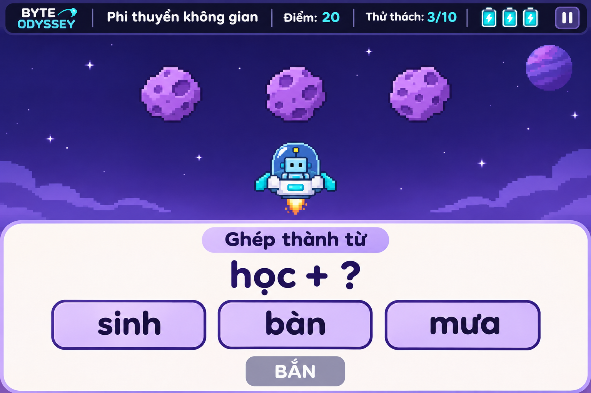

# Game 2 — Phi thuyền không gian

Trạng thái: game đã được triển khai trong phiên bản 0.1.1 theo thiết kế
dưới đây. Ảnh là phác thảo tham chiếu, không phải ảnh chụp runtime.

## Ý tưởng

Nhân vật được chọn làm phi công, điều khiển phi thuyền vượt qua vùng thiên
thạch để đến trạm vũ trụ. Giải đúng bài tập nhận diện chữ, ghép hoặc nối sẽ
kích hoạt phát bắn phá thiên thạch và mở đường.

Cả 10 nhân vật đã chốt đều có thể làm phi công, với cùng khả năng. Robot Byte
trong ảnh chỉ là nhân vật minh họa.

## Luồng chơi đề xuất

1. Chọn Game 2, nội dung luyện tập, nhân vật và một trong 6 map đã duyệt.
2. Phi thuyền bay đến một đợt thiên thạch rồi dừng ở khoảng cách an toàn.
3. Game hiện một bài tập trên bảng riêng. Thiên thạch chờ trong suốt thời gian làm bài.
4. Học sinh chọn, ghép hoặc nối đáp án. Có thể thay đổi lựa chọn trước khi xác nhận.
5. Bấm **Bắn** để xác nhận bài làm:
   - **Đúng:** phi thuyền tự bắn phá vật cản, nhận điểm và tiến sang đợt tiếp theo.
   - **Sai:** mất một ô năng lượng, nhận gợi ý và thử lại cùng bài tập nếu còn năng lượng.
6. Vượt đủ số thử thách thì đến trạm vũ trụ; hết năng lượng thì kết thúc lượt.

Game tự thực hiện phần ngắm và bắn sau khi chấm bài. Không chấm sai dựa vào
tốc độ thao tác. Bấm đổi lựa chọn hoặc ghép một phần chưa hoàn chỉnh chưa bị
trừ năng lượng; chỉ chấm khi học sinh xác nhận bài làm hợp lệ bằng nút **Bắn**.

## Nội dung luyện tập

Sử dụng cùng ba nhóm nội dung của dự án:

| Nhóm | Cách tương tác |
| --- | --- |
| Nhận diện chữ và phụ âm | Chọn chữ phù hợp để hoàn thành tiếng hoặc từ theo ngữ cảnh, tranh |
| Ghép vần và nhận diện dấu thanh | Chọn hoặc ghép các phần để tạo tiếng phù hợp với đề bài |
| Ghép từ và câu | Ghép tiếng thành từ, nối từ với tranh hoặc sắp xếp từ thành câu ngắn |

Ví dụ trong ảnh: **học + ?**, với các lựa chọn **sinh**, **bàn**, **mưa**.
Học sinh chọn **sinh** rồi bấm **Bắn** để hoàn thành từ **học sinh**.
Ba thiên thạch trong ảnh minh họa một đợt vật cản; không có nghĩa phải làm ba
bài tập cho một lượt xác nhận. Chỉ phá vật cản theo hoạt ảnh khi trả lời đúng.

## Lượt chơi và điểm đề xuất

Giữ cách tính quen thuộc của Game 1, đổi biểu tượng trái tim thành ô năng lượng:

- Một lượt gồm 10 thử thách, bắt đầu với 3 ô năng lượng.
- Đúng ngay lần đầu: 10 điểm cho thử thách đó.
- Đúng sau khi trả lời sai và nhận gợi ý: 5 điểm cho thử thách đó.
- Mỗi lần xác nhận sai mất một ô năng lượng; mỗi thử thách chỉ cộng điểm một lần.
- Hoàn thành 10 thử thách: đến trạm vũ trụ và kết thúc thành công.
- Hết năng lượng: kết thúc lượt; có thể thử lại hoặc về màn chuẩn bị.

## Màn hình và phản hồi

- Phía trên: tên game, điểm, tiến trình, ba ô năng lượng và nút tạm dừng.
- Ở giữa: phi thuyền, nhân vật phi công, thiên thạch và bối cảnh không gian.
- Phía dưới: bảng bài tập nền sáng, chữ tiếng Việt lớn và rõ dấu, các lựa chọn
  hoặc khu vực ghép/nối, nút **Bắn**.
- Nút **Bắn** chỉ dùng được khi bài làm đủ điều kiện xác nhận.
- Phản hồi đúng có hoạt ảnh phát bắn và lời khen ngắn; phản hồi sai có gợi ý
  rồi cho thử lại, không tiết lộ đáp án trước lần làm đầu tiên.

## Map và hồ sơ

Người dùng đã duyệt [6 map của Game 2](game-2-maps.md): Ngân hà tím, Tinh vân
hồng, Quỹ đạo Trái Đất, Vành đai Sao Thổ, Tinh cầu băng và Hành tinh lửa.

Các phương án tuân theo nguyên tắc map chỉ tạo sự mới mẻ về hình ảnh: đổi
cảnh nền và ngoại hình vật cản, giữ nguyên luật, độ khó, bố trí vật cản và
cách tính điểm trong cùng game. Với cùng cấu hình màn, các thiên thạch tương
ứng có cùng kích thước va chạm và hành vi; không thêm hiệu ứng riêng theo map.

Kết quả cuối lượt ghi nhận học sinh, thời điểm, game, map nếu có, nhân vật,
nhóm nội dung, điểm, tiến trình, số lần thử và các mục cần luyện thêm. Cách
lưu và đồng bộ hồ sơ dùng chung với hệ thống của dự án, sẽ được thiết kế kỹ thuật sau.
