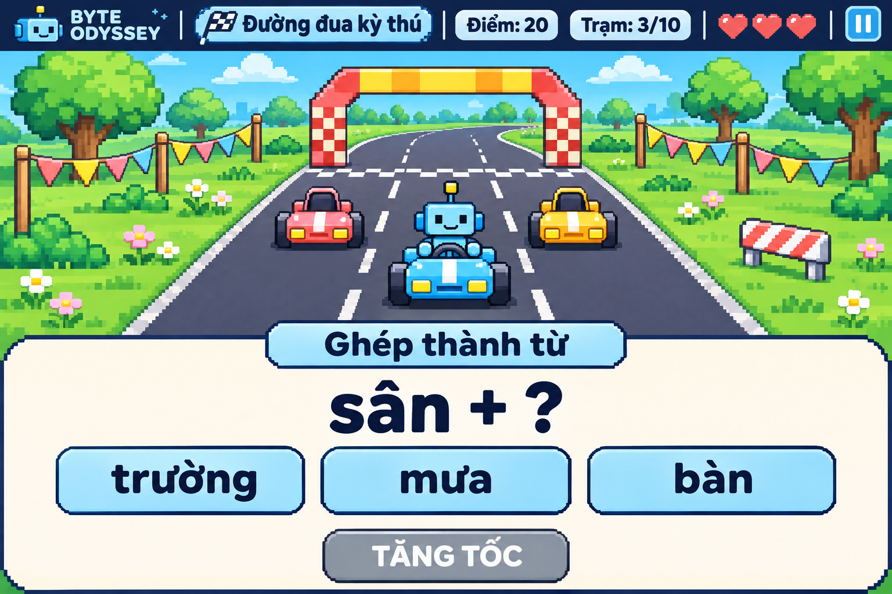

# Game 3 — Đường đua kỳ thú

Trạng thái: game đã được triển khai trong phiên bản 0.1.0 theo thiết kế
dưới đây. Ảnh là phác thảo tham chiếu, không phải ảnh chụp runtime.

## Ý tưởng

Học sinh chọn một trong 10 nhân vật làm tay đua, giúp xe vượt qua các trạm
thử thách để về đích. Mỗi bài tập nhận diện chữ, ghép hoặc nối được giải
đúng sẽ kích hoạt một chặng tăng tốc và vượt vật cản.

Cả 10 nhân vật có cùng khả năng. Robot Byte và đường đua công viên trong ảnh
chỉ dùng để minh họa. Người dùng đã duyệt bộ 6 map cho Game 3.

## Luồng chơi đề xuất

1. Vào Game 3, chọn nội dung luyện tập, nhân vật và một trong 6 map đã duyệt.
2. Xe tự chạy đến một trạm rồi dừng an toàn trước cổng và vật cản.
3. Game hiện bài tập trên bảng riêng, nền sáng và chữ rõ dấu.
4. Học sinh chọn, ghép hoặc nối đáp án; có thể sửa bài làm trước khi xác nhận.
5. Bấm **Tăng tốc** để xác nhận:
   - **Đúng:** cổng mở, xe tự tăng tốc qua một chặng và vượt vật cản theo hoạt ảnh.
   - **Sai:** xe chưa đi tiếp, mất một trái tim và nhận gợi ý để thử lại nếu còn tim.
6. Vượt đủ 10 trạm thì về đích; hết tim thì kết thúc lượt chơi.

Game tự điều khiển lái, chuyển làn và vượt vật cản trong hoạt ảnh. Học sinh
không bị trừ tim do thao tác lái hoặc tốc độ đọc. Chỉ chấm bài sau khi bấm
**Tăng tốc** với bài làm đủ điều kiện xác nhận.

Hai xe đi cùng tạo không khí cuộc đua. Chúng cũng chờ trong thời gian học
sinh làm bài, chỉ chuyển động trong hoạt ảnh giữa các trạm; không tự về đích
hoặc làm học sinh thua khi đang đọc. Đề xuất này xác định thành công bằng
việc hoàn thành 10 trạm, chưa thêm cơ chế xếp hạng đua theo thời gian.

## Nội dung luyện tập

Dùng chung ba nhóm nội dung: nhận diện chữ và phụ âm; ghép vần và nhận diện
dấu thanh; ghép từ và câu. Các bài có thể là chọn chữ còn thiếu, ghép các
phần thành tiếng hoặc từ, nối từ với tranh và sắp xếp từ thành câu ngắn.

Ví dụ trong ảnh: **sân + ?**, với các lựa chọn **trường**, **mưa**, **bàn**.
Chọn **trường** rồi bấm **Tăng tốc** để hoàn thành từ **sân trường** và vượt trạm.

## Lượt chơi và điểm đề xuất

- Một lượt gồm 10 trạm thử thách, bắt đầu với 3 trái tim.
- Đúng ngay lần đầu: 10 điểm cho thử thách đó.
- Đúng sau khi trả lời sai và nhận gợi ý: 5 điểm cho thử thách đó.
- Mỗi lần xác nhận sai mất một trái tim; mỗi trạm chỉ cộng điểm một lần.
- Về đích sau 10 trạm: kết thúc thành công và hiện kết quả.
- Hết tim: kết thúc lượt, cho phép thử lại hoặc quay về màn chuẩn bị.
- Không tính thêm điểm theo thời gian đọc hay thao tác.

## Màn hình, map và hồ sơ

- Phía trên: tên game, điểm, tiến trình trạm, trái tim và nút tạm dừng.
- Ở giữa: đường đua, xe của nhân vật, xe đi cùng, cổng trạm và vật cản.
- Phía dưới: bảng bài tập, các lựa chọn hoặc khu vực ghép/nối, nút **Tăng tốc**.
- Nút **Tăng tốc** chỉ dùng được khi bài làm đủ điều kiện xác nhận.

Người dùng đã duyệt [6 map của Game 3](game-3-maps.md): Công viên xanh,
Đường đua ven biển, Phố sắc màu, Làng quê Việt, Thung lũng tuyết và Xứ sở kẹo.

Map chỉ thay cảnh nền và ngoại hình cổng, vật cản; trong cùng cấu hình màn, bố trí, kích thước
va chạm, hành vi, luật, tốc độ hoạt ảnh và độ khó không đổi. Các chi tiết
băng, cát hoặc cảnh quan tương tự nếu xuất hiện chỉ mang tính trang trí.

Kết quả cuối lượt ghi nhận học sinh, thời điểm, game, map, nhân vật, nhóm
nội dung, điểm, số trạm hoàn thành, số lần thử và các mục cần luyện thêm.
Cách lưu và đồng bộ hồ sơ sẽ dùng chung với hệ thống của dự án.
