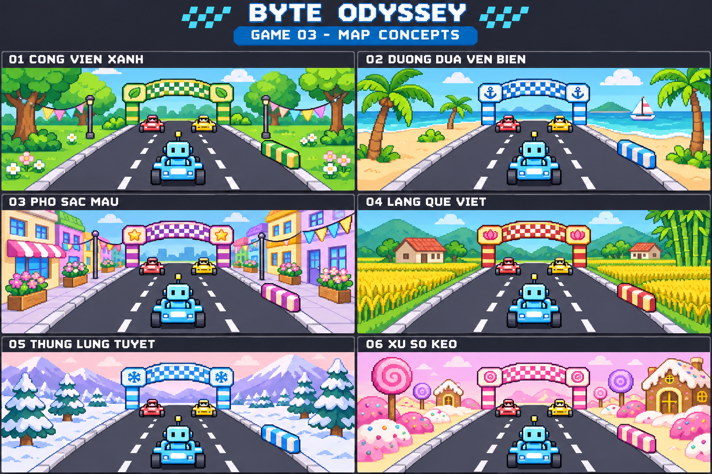

# Đường đua kỳ thú — Sáu map đã duyệt

Người dùng đã duyệt bộ 6 map dưới đây cho Game 3.

| Mã | Tên map | Cảnh quan | Ngoại hình cổng và vật cản |
| --- | --- | --- | --- |
| 01 | Công viên xanh | Cây xanh, thảm cỏ, hoa nhỏ và cờ trang trí | Màu xanh lá và vàng, họa tiết lá |
| 02 | Đường đua ven biển | Biển xanh, bãi cát, cây dừa và thuyền buồm phía xa | Màu xanh biển và trắng, họa tiết mỏ neo |
| 03 | Phố sắc màu | Nhà thấp tầng nhiều màu, vỉa hè và chậu hoa | Màu tím và kem, họa tiết sao |
| 04 | Làng quê Việt | Đồng lúa, nhà mái ngói, tre và đồi xanh | Màu đỏ và vàng, họa tiết sen |
| 05 | Thung lũng tuyết | Núi tuyết, cây thông và trời hồng nhạt | Màu xanh băng và trắng, họa tiết bông tuyết |
| 06 | Xứ sở kẹo | Cây kẹo, nhà bánh và cảnh quan hồng pastel | Màu hồng và kem, họa tiết kẹo |

## Cơ chế dùng chung

- Các map chỉ thay cảnh nền và ngoại hình cổng, vật cản để tạo sự mới mẻ.
- Cùng cấu hình màn thì đường đua, số làn, số trạm, bộ vật cản, vị trí,
  khoảng cách, kích thước va chạm và hành vi đều giống nhau.
- Xe, tốc độ hoạt ảnh, cách vượt vật cản, luật, độ khó và điểm không đổi theo map.
- Cả 10 nhân vật đều có thể làm tay đua trên mọi map. Robot Byte trong ảnh
  chỉ là nhân vật minh họa.
- Mặt đường vẫn dùng cùng cơ chế; tuyết, cát, biển và kẹo là cảnh trang trí,
  không tạo hiệu ứng trượt, giảm tốc hay thêm chướng ngại vật.
- Tất cả xe chờ khi học sinh làm bài theo thiết kế Game 3.
- Bài tập phụ thuộc nhóm nội dung luyện tập, không phụ thuộc map.
- Ảnh là phác thảo để chọn phong cách, chưa phải bộ tài nguyên chạy trong game.

Học sinh hoặc giáo viên được chọn map khi chuẩn bị lượt chơi. Chọn map không
thay đổi nội dung luyện tập hoặc độ khó.
