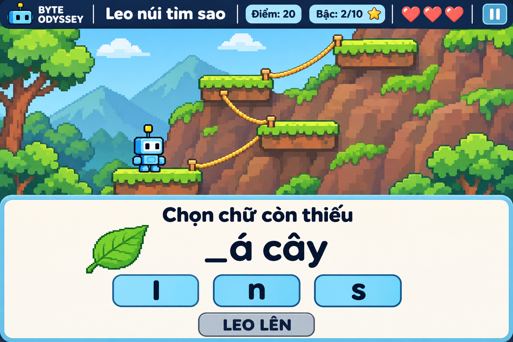

# Game 4 — Leo núi tìm sao

Trạng thái: game đã được triển khai trong phiên bản 0.1.0 theo thiết kế
dưới đây. Ảnh là phác thảo tham chiếu, không phải ảnh chụp runtime.

## Ý tưởng

Học sinh chọn một trong 10 nhân vật, giải bài tập để leo qua 10 bậc và tìm
ngôi sao ở điểm cao nhất. Nhân vật tự bám dây, leo hoặc bước sang bậc kế
tiếp sau khi bài làm được chấm đúng.

Cả 10 nhân vật có cùng khả năng. Robot Byte trong ảnh là nhân vật minh họa.

## Luồng chơi đề xuất

1. Chọn Game 4, nhóm nội dung luyện tập, nhân vật và một trong 6 map đã duyệt.
2. Nhân vật đứng trên bậc an toàn, chờ bài tập trên bảng riêng.
3. Học sinh chọn, ghép hoặc nối đáp án; có thể sửa bài làm trước khi xác nhận.
4. Bấm **Leo lên** để xác nhận bài làm:
   - **Đúng:** nhân vật tự leo lên một bậc, nhận điểm và mở thử thách kế tiếp.
   - **Sai:** nhân vật trượt nhẹ rồi trở về bậc đang đứng, mất một trái tim,
     nhận gợi ý và được thử lại cùng bài nếu còn tim.
5. Hoàn thành 10 bậc để nhận ngôi sao ở đỉnh và kết thúc thành công.
6. Hết tim thì kết thúc lượt, cho phép thử lại hoặc về màn chuẩn bị.

Bậc đã vượt qua được giữ khi trả lời sai; không bắt học sinh làm lại các
bài đã hoàn thành và không cộng lại điểm của bậc cũ. Nhân vật đứng yên an
toàn trong thời gian làm bài, không tự trượt hoặc bị rơi vì đọc chậm.

Game tự điều khiển phần leo và giữ thăng bằng. Nút **Leo lên** chỉ dùng
được khi bài làm đủ điều kiện xác nhận; sửa lựa chọn hoặc ghép dở bài chưa
bị trừ tim. Không yêu cầu bấm đúng nhịp, nhảy bằng phản xạ hoặc chạy đua thời gian.

## Nội dung luyện tập

Dùng chung ba nhóm: nhận diện chữ và phụ âm; ghép vần và nhận diện dấu
thanh; ghép từ và câu. Có thể chọn chữ còn thiếu, ghép tiếng hoặc từ, nối
từ với tranh và sắp xếp từ thành câu ngắn.

Ví dụ trong ảnh: đề bài **_á cây**, có tranh chiếc lá, lựa chọn **l**, **n**,
**s**. Học sinh chọn **l** rồi bấm **Leo lên** để hoàn thành **lá cây**.
Ảnh minh họa đã vượt 2 bậc, được 20 điểm, đang chờ bài để lên bậc thứ 3.

## Lượt chơi, điểm và ngôi sao đề xuất

- Một lượt có 10 bậc thử thách và bắt đầu với 3 trái tim.
- Đúng ngay lần đầu: 10 điểm cho thử thách đó.
- Đúng sau khi trả lời sai và nhận gợi ý: 5 điểm cho thử thách đó.
- Mỗi lần xác nhận sai mất một trái tim; mỗi thử thách chỉ cộng điểm một lần.
- Ngôi sao ở đỉnh biểu thị hoàn thành màn, không cộng thêm điểm ngoài luật trên.
- Hết tim thì kết thúc lượt. Không tính điểm theo thời gian đọc hoặc thao tác.

## Màn hình và map

- Phía trên: tên game, điểm, số bậc đã vượt trên tổng 10, biểu tượng sao đích,
  ba trái tim và nút tạm dừng.
- Ở giữa: nhân vật, bậc đứng, dây leo và những bậc lân cận. Camera theo nhân
  vật lên cao; ảnh chỉ cho thấy một phần đường leo, không phải toàn bộ 10 bậc.
- Phía dưới: bảng bài tập nền sáng, chữ rõ dấu, lựa chọn hoặc khu vực ghép/nối,
  nút **Leo lên**.

Người dùng đã duyệt [6 map của Game 4](game-4-maps.md): Núi rừng xanh, Cây cổ thụ,
Đỉnh mây, Núi tuyết, Hang tinh thể và Tháp bánh kẹo.

Map chỉ thay cảnh nền và ngoại hình bậc leo, vách, dây. Với cùng cấu hình
màn, số bậc, vị trí, khoảng cách, kích thước va chạm, đường leo, luật và độ
khó giống nhau. Tuyết, tinh thể và bánh kẹo không thêm cơ chế trượt, vỡ,
nảy hoặc giới hạn thời gian.

## Kết quả và hồ sơ

Lưu học sinh, thời điểm, game, map, nhân vật, nhóm nội dung, điểm, số bậc
hoàn thành, kết quả nhận sao, số lần thử và các mục cần luyện thêm. Cách lưu
và đồng bộ dùng chung với hệ thống của dự án, sẽ thiết kế kỹ thuật sau.
