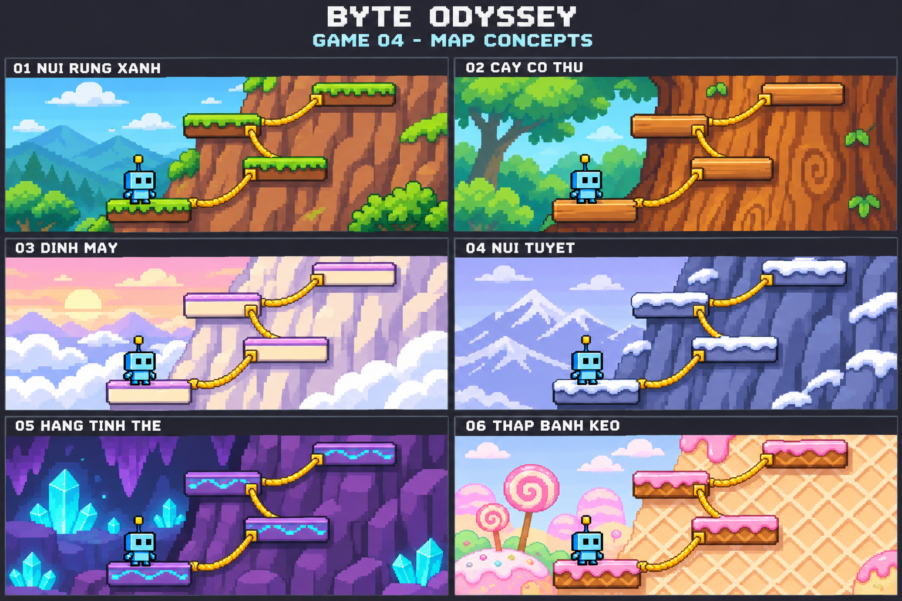

# Leo núi tìm sao — Sáu map đã duyệt

Người dùng đã duyệt bộ 6 map dưới đây cho Game 4.

| Mã | Tên map | Bối cảnh | Ngoại hình bậc leo |
| --- | --- | --- | --- |
| 01 | Núi rừng xanh | Vách núi nâu, rừng xanh và núi xa | Đá phủ rêu và cỏ |
| 02 | Cây cổ thụ | Thân cây lớn, tán lá xanh | Bậc gỗ gắn vào thân cây |
| 03 | Đỉnh mây | Vách sáng màu, mây trắng và trời bình minh | Đá kem viền tím nhạt |
| 04 | Núi tuyết | Núi xanh xám, tuyết trắng và trời tím nhạt | Đá phủ tuyết |
| 05 | Hang tinh thể | Vách hang tím, tinh thể xanh phát sáng ở hậu cảnh | Đá tím có họa tiết xanh |
| 06 | Tháp bánh kẹo | Tháp bánh xốp, đồi kẹo và cây kẹo | Bậc bánh viền kem hồng |

## Cơ chế dùng chung

- Các map chỉ thay cảnh nền, màu và ngoại hình vách, bậc leo, dây để tạo sự mới mẻ.
- Cùng cấu hình màn thì số bậc, vị trí, khoảng cách, kích thước va chạm, các
  điểm bám dây và hành vi của bậc leo giống nhau.
- Bố trí đường leo, tốc độ hoạt ảnh, luật 10 thử thách và 3 tim, điểm, gợi ý
  và điều kiện kết thúc không đổi theo map.
- Băng tuyết, tinh thể, gỗ và bánh kẹo chỉ là ngoại hình; không tạo trượt,
  gãy, nảy hoặc thêm vật cản riêng.
- Cả 10 nhân vật đều có thể dùng trên mọi map. Robot Byte trong ảnh chỉ để minh họa.
- Nhân vật chờ an toàn khi làm bài; không tự rơi hoặc mất tim vì đọc chậm.
- Bảng ảnh dùng cùng một đoạn 4 bậc lân cận để so sánh hình ảnh, không thay
  đổi thiết kế 10 bậc cho mỗi lượt chơi.
- Bài tập phụ thuộc nhóm nội dung luyện tập, không phụ thuộc map.
- Ảnh là phác thảo để chọn phong cách, chưa phải bộ tài nguyên chạy trong game.

Học sinh hoặc giáo viên được chọn map khi chuẩn bị lượt chơi. Chọn map không
thay đổi nội dung luyện tập hoặc độ khó.
