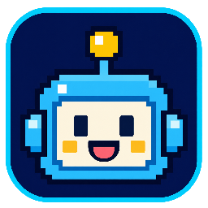

# Icon ứng dụng Byte Odyssey

Trạng thái: icon đã được sử dụng trong ứng dụng web, cửa sổ Electron và
cấu hình đóng gói bộ cài/lối tắt Windows của phiên bản 0.1.1.

## Thiết kế đề xuất

- Dùng khuôn mặt Robot Byte theo phong cách của màn hình chính đã duyệt.
- Robot xanh, mặt kem, mắt và viền xanh đậm, đầu ăng-ten vàng, nét mặt vui tươi.
- Nền huy hiệu vuông bo góc xanh đậm, viền xanh sáng, bên ngoài trong suốt.
- Không đặt tên dài trong icon để hình dễ nhận ra khi thu nhỏ trên máy tính.

## File đã xuất

| File | Đặc điểm | Mục đích |
| --- | --- | --- |
| [PNG gốc](../assets/branding/byte-odyssey-icon.png) | 1254 × 1254, RGBA, nền ngoài trong suốt | Lưu mẫu thiết kế chất lượng cao |
| [PNG 256](../assets/branding/byte-odyssey-icon-256.png) | 256 × 256, RGBA | Xem trước và dùng ở vị trí cần ảnh PNG |
| [ICO Windows](../assets/branding/byte-odyssey-icon.ico) | Chứa 16, 24, 32, 48, 64, 128 và 256 px | Tích hợp biểu tượng ứng dụng, bộ cài và lối tắt Windows |

Các file xuất giữ nguyên mẫu thiết kế, chỉ đổi kích thước và định dạng.
Đã kiểm tra giải mã được cả 7 kích thước trong ICO và giữ kênh trong suốt.

## Dùng trong bản phát hành trên GitHub

Để người tải từ GitHub nhìn thấy icon này khi cài và mở game, bước đóng gói
sẽ cần nhúng ICO vào tệp chạy, bộ cài và cấu hình lối tắt của ứng dụng.
Cấu hình Electron Builder trong `package.json` đã dùng file ICO cho ứng
dụng, installer, uninstaller và lối tắt. Workflow GitHub Actions build trên
Windows và đính kèm bộ cài vào Release khi push tag phiên bản.

## Mẫu nhận diện đang sử dụng

Khuôn mặt Robot Byte, màu sắc và nền huy hiệu của icon.
