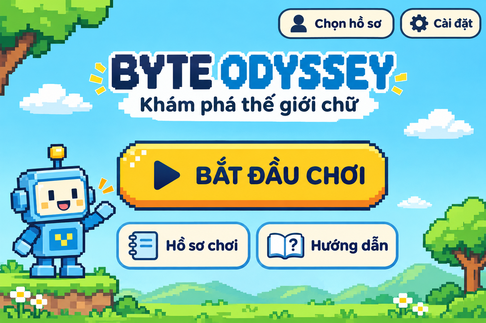
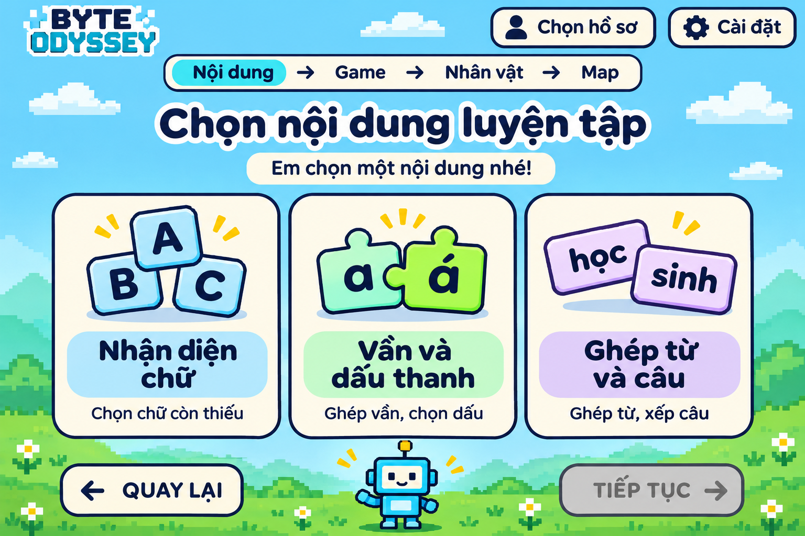
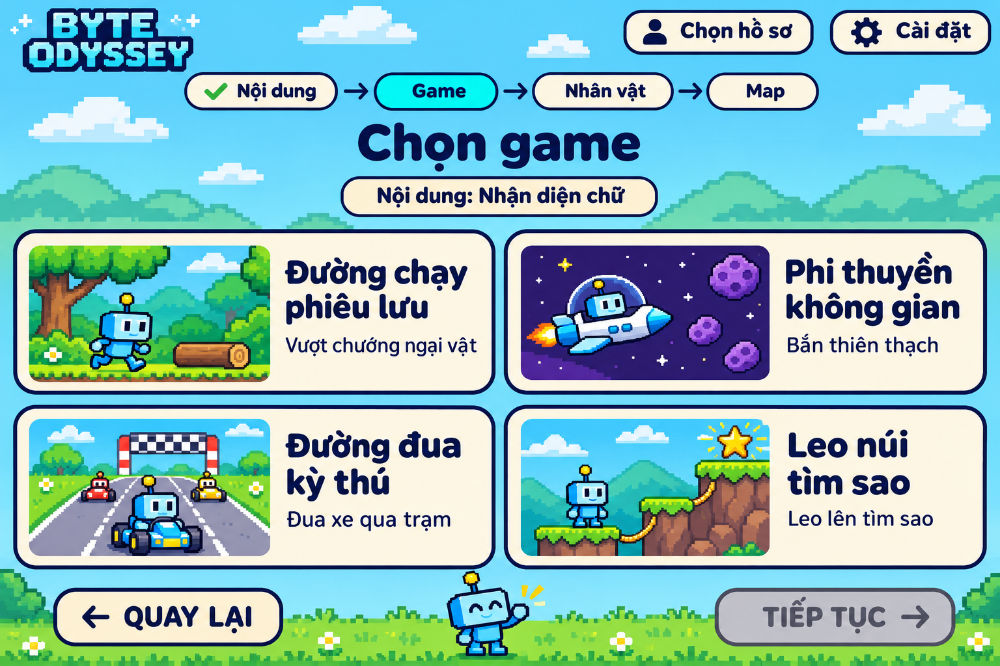
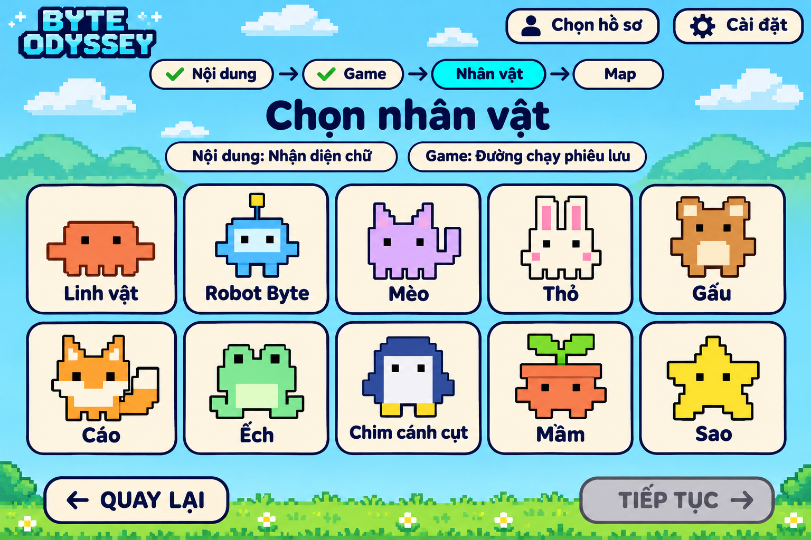
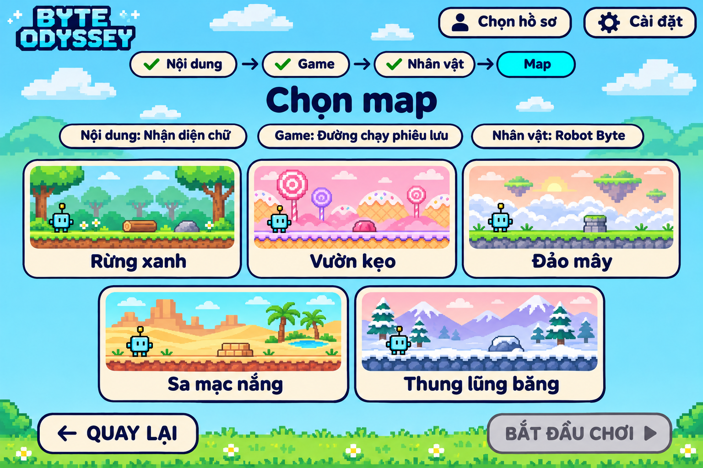
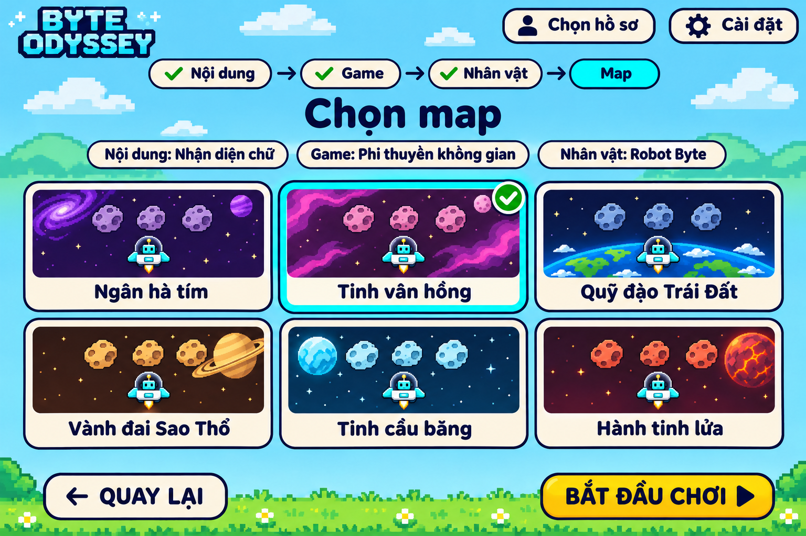

# Màn hình chính và luồng chọn trước khi chơi

Luồng này đã được triển khai trong phiên bản 0.1.0. Các ảnh bên dưới là
phác thảo đã duyệt trước khi viết mã; xem [README](../README.md) và
[src/App.tsx](../src/App.tsx) cho phiên bản chạy được.

## Quy trình duyệt theo yêu cầu người dùng

Thiết kế lần lượt từng bước. Mỗi bước phải có đề xuất cụ thể và ảnh phác
thảo, sau đó hỏi người dùng có đồng ý không và muốn chỉnh sửa chỗ nào.
Nếu có yêu cầu sửa, cập nhật bước đó để duyệt lại. Chỉ chuyển sang bước
tiếp theo sau khi người dùng đồng ý; không tự thiết kế toàn bộ các màn
khi chưa nhận được phản hồi.

Luồng đã thống nhất: **Màn hình chính → Chọn nội dung → Chọn game →
Chọn nhân vật → Chọn map → Chơi**.

| Bước | Màn hình | Trạng thái |
| --- | --- | --- |
| 1 | Màn hình chính | Người dùng đã duyệt |
| 2 | Chọn nội dung luyện tập | Người dùng đã duyệt |
| 3 | Chọn một trong 4 game | Người dùng đã duyệt |
| 4 | Chọn một trong 10 nhân vật | Người dùng đã duyệt |
| 5 | Chọn map của game đã chọn | Người dùng đã duyệt |

Toàn bộ 5 màn hình trong luồng chuẩn bị đã được người dùng duyệt ở mức
thiết kế. Các ảnh và mô tả dưới đây là cơ sở để triển khai giao diện.

## Bước 1 — Màn hình chính, đã duyệt

Trạng thái: người dùng đã đồng ý với thiết kế, chưa phải giao diện đã triển khai.

### Bố cục

- Nền trời xanh, đồi cỏ và cây theo phong cách pixel; khu vực nút ít chi tiết.
- Logo **BYTE ODYSSEY** và dòng **Khám phá thế giới chữ** ở phía trên.
- Nút chính màu vàng **Bắt đầu chơi** lớn, dễ nhận biết ở giữa.
- Hai nút phụ **Hồ sơ chơi** và **Hướng dẫn** bên dưới.
- Góc trên bên phải: **Chọn hồ sơ** và **Cài đặt**, có biểu tượng kèm chữ.
- Robot Byte đứng bên trái làm nhân vật hướng dẫn trang trí. Đây không phải
  lựa chọn nhân vật mặc định; người chơi vẫn chọn nhân vật tại bước 4.
- Chữ tiếng Việt dùng phông rõ dấu, tương phản cao; các vùng bấm rộng và tách biệt.

### Ý nghĩa các nút đề xuất

| Nút | Chức năng |
| --- | --- |
| Bắt đầu chơi | Chuyển sang màn chọn nội dung luyện tập, là bước 2 của luồng |
| Chọn hồ sơ | Mở phần chọn hồ sơ học sinh để gắn kết quả với đúng người chơi |
| Hồ sơ chơi | Mở lịch sử và kết quả luyện tập của hồ sơ được chọn |
| Hướng dẫn | Mở hướng dẫn ngắn về cách chọn bài, làm bài và nhận kết quả |
| Cài đặt | Điểm truy cập phần cài đặt cơ bản, chi tiết sẽ được thiết kế riêng |

Các màn phụ về hồ sơ, hướng dẫn và cài đặt sẽ được thiết kế riêng. Bước này
duyệt màn hình chính và các điểm truy cập, chưa xác định quy trình tạo hồ
sơ hoặc công nghệ lưu dữ liệu.

### Nội dung đã được người dùng duyệt

- Bố cục, màu sắc và cách thể hiện Robot Byte.
- Tên, số lượng và vị trí các nút trên màn hình chính.
- Nút **Bắt đầu chơi** dẫn đến **Chọn nội dung luyện tập**.

Người dùng đã duyệt bước 1 và cho phép chuyển sang bước 2.

## Bước 2 — Chọn nội dung luyện tập, đã duyệt

Trạng thái: người dùng đã đồng ý với thiết kế, chưa phải giao diện đã triển khai.

### Bố cục và ba lựa chọn

- Giữ nền pixel trời xanh, đồi cỏ, các bảng màu kem và chữ xanh đậm theo
  màn hình chính đã duyệt.
- Logo thu gọn ở góc trên trái; **Chọn hồ sơ** và **Cài đặt** ở phía trên phải.
- Thanh tiến trình **Nội dung → Game → Nhân vật → Map**, làm nổi bật **Nội dung**.
  Đây là phần chuẩn bị lượt chơi, không tính màn hình chính vào thanh tiến trình.
- Tiêu đề **Chọn nội dung luyện tập**, hướng dẫn **Em chọn một nội dung nhé!**.
- Ba thẻ lớn ngang hàng; toàn bộ thẻ là vùng bấm, không có lựa chọn mặc định.

| Tên trên thẻ | Minh họa và mô tả ngắn | Nhóm nội dung tương ứng |
| --- | --- | --- |
| Nhận diện chữ | Thẻ A, B, C; Chọn chữ còn thiếu | Nhận diện chữ và phụ âm trong tiếng, từ theo tranh hoặc ngữ cảnh |
| Vần và dấu thanh | Mảnh ghép a, á; Ghép vần, chọn dấu | Ghép vần và nhận diện dấu thanh để tạo tiếng phù hợp |
| Ghép từ và câu | Hai mảnh học, sinh; Ghép từ, xếp câu | Ghép tiếng thành từ, nối từ với tranh, sắp xếp từ thành câu ngắn |

- Robot Byte nhỏ ở phía dưới là hình trang trí, không phải nhân vật đã chọn.
- Nút **Quay lại** ở dưới trái; **Tiếp tục** ở dưới phải.

### Tương tác đề xuất

1. Lần đầu vào màn, cả ba thẻ đều chưa được chọn; **Tiếp tục** có màu xám
   và chưa dùng được, như trong ảnh phác thảo.
2. Học sinh hoặc giáo viên chọn đúng một nhóm nội dung. Thẻ được chọn có
   viền nổi bật và dấu tích; nút **Tiếp tục** chuyển sang màu vàng và dùng được.
3. Chọn thẻ khác sẽ thay lựa chọn trước. Việc chọn thẻ chưa tự chuyển màn.
4. Bấm **Tiếp tục** để mang nội dung đã chọn sang bước 3, màn chọn game.
5. **Quay lại** đưa về màn hình chính. Nếu quay về màn này từ màn chọn game
   trong cùng lượt chuẩn bị, giữ lựa chọn nội dung để có thể xem hoặc đổi.

Cả ba nhóm được chọn tự do. Nội dung đã chọn sẽ áp dụng cho game được chọn
ở bước sau; bước này chưa chọn game, nhân vật hoặc map.

### Nội dung đã được người dùng duyệt

- Bố cục ba thẻ, màu sắc, hình minh họa, tên và mô tả ngắn của từng nhóm.
- Cách chọn một thẻ rồi xác nhận bằng **Tiếp tục**.
- Vị trí **Quay lại**, **Tiếp tục** và thanh tiến trình.

Người dùng đã duyệt bước 2 và cho phép chuyển sang bước 3.

## Bước 3 — Chọn game, đã duyệt

Trạng thái: người dùng đã đồng ý với thiết kế, chưa phải giao diện đã triển khai.

### Bố cục và bốn lựa chọn

- Giữ phong cách pixel trời xanh, bảng màu kem, chữ xanh đậm, logo, **Chọn
  hồ sơ** và **Cài đặt** theo các màn đã duyệt.
- Thanh tiến trình **Nội dung → Game → Nhân vật → Map** đánh dấu nội dung
  đã chọn và làm nổi bật **Game**.
- Tiêu đề **Chọn game**, bên dưới có nhãn hiển thị nội dung luyện tập đã chọn.
  Nhãn **Nội dung: Nhận diện chữ** trong ảnh chỉ là ví dụ, không mặc định
  chọn thay học sinh ở bước 2.
- Bốn thẻ lớn xếp thành lưới 2 × 2, hiển thị đủ trong một màn hình. Mỗi
  thẻ có ảnh minh họa bên trái, tên và mô tả ngắn bên phải.

| Vị trí | Tên game | Minh họa | Mô tả ngắn |
| --- | --- | --- | --- |
| Trên trái | Đường chạy phiêu lưu | Robot, đường rừng và khúc gỗ | Vượt chướng ngại vật |
| Trên phải | Phi thuyền không gian | Robot trong phi thuyền và thiên thạch tím | Bắn thiên thạch |
| Dưới trái | Đường đua kỳ thú | Robot lái xe và cổng trạm | Đua xe qua trạm |
| Dưới phải | Leo núi tìm sao | Robot, bậc đá, dây leo và biểu tượng sao | Leo lên tìm sao |

- Toàn bộ thẻ là vùng bấm; không có nút chọn nhỏ lồng trong thẻ.
- Robot Byte trong ảnh minh họa và hình trang trí không phải nhân vật đã
  được chọn. Người chơi vẫn chọn một trong 10 nhân vật ở bước 4.
- Nút **Quay lại** dưới trái và **Tiếp tục** dưới phải, nhất quán với bước 2.

### Tương tác đề xuất

1. Lần đầu vào màn, giữ nội dung đã chọn ở bước 2. Cả bốn game đều chưa
   được chọn, nên **Tiếp tục** có màu xám và chưa dùng được như trong ảnh.
2. Chọn một thẻ game để làm nổi bật viền, hiện dấu tích và bật nút **Tiếp
   tục** màu vàng. Chọn thẻ khác thay lựa chọn cũ; chưa tự chuyển màn.
3. Bấm **Tiếp tục** để mang nội dung và game đã chọn sang bước 4, chọn nhân vật.
4. **Quay lại** trở về chọn nội dung. Cả bốn game đều dùng được với ba nhóm
   nội dung, không giới hạn trò chơi theo kết quả học tập hoặc map.
5. Quay về từ bước chọn nhân vật thì giữ game đang chọn để xem hoặc đổi.
   Nếu đổi game khi lượt chuẩn bị đã có map, bỏ lựa chọn map cũ để chọn
   đúng bộ map của game mới ở bước 5.

### Nội dung đã được người dùng duyệt

- Lưới 2 × 2, ảnh minh họa, tên và mô tả của bốn game.
- Nhãn nhắc nội dung luyện tập đã chọn và thanh tiến trình.
- Cách chọn một game rồi xác nhận bằng **Tiếp tục**, quay về bằng **Quay lại**.

Người dùng đã duyệt bước 3 và cho phép chuyển sang bước 4.

## Bước 4 — Chọn nhân vật, đã duyệt

Trạng thái: người dùng đã đồng ý với thiết kế, chưa phải giao diện đã triển khai.

### Bố cục và bộ nhân vật

- Giữ giao diện trời xanh, đồi cỏ, bảng màu kem và chữ xanh đậm theo các màn đã duyệt.
- Thanh **Nội dung → Game → Nhân vật → Map** đánh dấu hai lựa chọn đầu đã
  hoàn thành, làm nổi bật **Nhân vật**.
- Tiêu đề **Chọn nhân vật**, phía dưới hiển thị nội dung luyện tập và game
  đã chọn. Các nhãn trong ảnh là ví dụ, không chọn mặc định thay người chơi.
- Hiển thị đủ 10 thẻ trong lưới 5 cột × 2 hàng, mỗi thẻ có hình toàn thân
  và tên rõ ràng. Toàn bộ thẻ là vùng bấm, không có nút nhỏ lồng bên trong.
- Không có nhân vật nào được chọn sẵn. Tất cả đều được chọn tự do, có cùng
  khả năng trong từng game và dùng được trên mọi map tương ứng.

| Mã | Tên hiển thị đã duyệt | Vị trí |
| --- | --- | --- |
| 01 | Linh vật | Hàng trên, cột 1 |
| 02 | Robot Byte | Hàng trên, cột 2 |
| 03 | Mèo | Hàng trên, cột 3 |
| 04 | Thỏ | Hàng trên, cột 4 |
| 05 | Gấu | Hàng trên, cột 5 |
| 06 | Cáo | Hàng dưới, cột 1 |
| 07 | Ếch | Hàng dưới, cột 2 |
| 08 | Chim cánh cụt | Hàng dưới, cột 3 |
| 09 | Mầm | Hàng dưới, cột 4 |
| 10 | Sao | Hàng dưới, cột 5 |

Nhân vật 01 giữ hình dáng linh vật cam trong ảnh người dùng đã gửi; **Linh
vật** là tên hiển thị đã duyệt. Các nhân vật 02–10 dùng lại [bộ hình đã được
duyệt](assets/characters-02-10-reference.png), giữ màu sắc và hình dáng pixel đơn giản.
Ảnh phác thảo không phải bộ khung hình hoạt ảnh để chạy game.

### Tương tác đề xuất

1. Giữ nội dung và game từ các bước trước. Lần đầu vào màn chưa chọn nhân
   vật, nên **Tiếp tục** màu xám và chưa dùng được như trong ảnh.
2. Chọn một thẻ để hiện viền nổi bật và dấu tích, bật **Tiếp tục** màu vàng.
   Chọn thẻ khác thay lựa chọn cũ, chưa tự chuyển màn.
3. Bấm **Tiếp tục** để mang nội dung, game và nhân vật sang bước 5, chọn map.
4. **Quay lại** trở về màn chọn game. Khi quay lại từ màn chọn map, giữ
   nhân vật đang chọn để xem hoặc đổi.
5. Đổi nhân vật không làm thay đổi nội dung, game hoặc map đã chọn, vì cả
   10 nhân vật có thể tham gia mọi game và map trong phạm vi thiết kế.

### Nội dung đã được người dùng duyệt

- Lưới 5 × 2, hình ảnh và tên hiển thị của đủ 10 nhân vật.
- Các nhãn nhắc nội dung, game và thanh tiến trình.
- Cách chọn một nhân vật rồi bấm **Tiếp tục**, quay về bằng **Quay lại**.

Người dùng đã duyệt bước 4 và cho phép chuyển sang bước 5.

## Bước 5 — Chọn map, đã duyệt

Trạng thái: người dùng đã đồng ý với thiết kế, chưa phải giao diện đã triển khai.

### Hai trạng thái minh họa

**Ảnh A — Game 1, chưa chọn map:** hiển thị đúng 5 map đã duyệt, nút
**Bắt đầu chơi** màu xám và chưa dùng được.

**Ảnh B — Game 2, sau khi chọn map:** hiển thị đúng 6 map đã duyệt, thẻ
**Tinh vân hồng** có viền nổi bật và dấu tích, **Bắt đầu chơi** màu vàng và dùng được.

Nội dung **Nhận diện chữ**, nhân vật **Robot Byte** và các game trong hai
ảnh chỉ là dữ liệu ví dụ từ các bước trước. Ảnh B mô phỏng trạng thái sau
khi người chơi bấm chọn, không phải map được chọn mặc định.

### Bố cục dùng chung cho bốn game

- Giữ logo, nền trời xanh, bảng màu kem, chữ xanh đậm, **Chọn hồ sơ** và
  **Cài đặt** theo các màn đã duyệt.
- Thanh **Nội dung → Game → Nhân vật → Map** đánh dấu ba lựa chọn trước đã
  hoàn thành và làm nổi bật **Map**.
- Tiêu đề **Chọn map**; bên dưới nhắc nội dung luyện tập, game và nhân vật đang chọn.
- Mỗi thẻ có ảnh bối cảnh và tên rõ ràng, toàn bộ thẻ là vùng bấm.
- Game 1 có ba thẻ hàng trên, hai thẻ hàng dưới đặt giữa; không tạo thẻ thứ 6.
- Game 2, 3 và 4 có sáu thẻ xếp ba cột × hai hàng.
- **Quay lại** dưới trái; nút cuối **Bắt đầu chơi** dưới phải thay cho **Tiếp tục**.

| Game đang chọn | Số map hiển thị | Nguồn danh sách đã duyệt |
| --- | --- | --- |
| Đường chạy phiêu lưu | 5 | [Các map Game 1](game-1-maps.md) |
| Phi thuyền không gian | 6 | [Các map Game 2](game-2-maps.md) |
| Đường đua kỳ thú | 6 | [Các map Game 3](game-3-maps.md) |
| Leo núi tìm sao | 6 | [Các map Game 4](game-4-maps.md) |

Chỉ hiển thị bộ map của game đã chọn, không trộn 23 map vào cùng màn. Các
map đều được chọn tự do, không có mức khó hay điều kiện mở khóa. Map chỉ
đổi hình ảnh; luật, bộ vật cản, bố trí và độ khó trong cùng game giữ nguyên.

### Tương tác đề xuất

1. Lần đầu vào màn chưa chọn map; giữ nguyên nội dung, game và nhân vật
   từ các bước trước. **Bắt đầu chơi** màu xám, chưa dùng được.
2. Chọn một thẻ để hiện viền nổi bật và dấu tích, bật **Bắt đầu chơi** màu
   vàng. Chọn thẻ khác thay lựa chọn cũ, không tự vào game ngay.
3. Bấm **Bắt đầu chơi** khi đủ nội dung, game, nhân vật và map hợp lệ để
   vào đúng game, dùng đúng map và nhân vật, luyện đúng nội dung đã chọn.
4. **Quay lại** đưa về chọn nhân vật và giữ lựa chọn map trong cùng lượt
   chuẩn bị. Đổi nhân vật vẫn giữ map vì mọi nhân vật đều dùng được.
5. Nếu quay về đổi game, bỏ lựa chọn map cũ và chỉ hiển thị bộ map của
   game mới; cần chọn lại map trước khi bắt đầu.

### Nội dung đã được người dùng duyệt

- Bố cục năm và sáu thẻ, ảnh bối cảnh, tên map và các nhãn nhắc lựa chọn trước.
- Trạng thái chưa chọn và đã chọn, viền và dấu tích trên thẻ.
- Nút **Bắt đầu chơi** là thao tác xác nhận cuối, **Quay lại** về chọn nhân vật.

Người dùng đã duyệt bước 5. Toàn bộ luồng **Màn hình chính → Chọn nội dung
→ Chọn game → Chọn nhân vật → Chọn map → Chơi** đã được duyệt.
